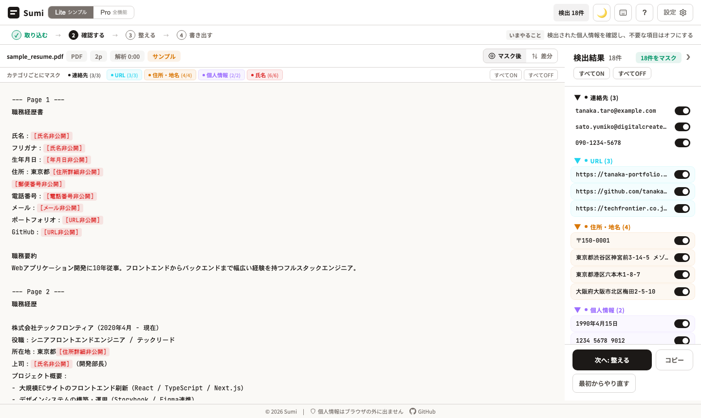

# Sumi

日本語の履歴書・職務経歴書から氏名・連絡先・住所などの個人情報を自動で検出し、マスキングするツールです。人材紹介や採用の現場で、候補者の書類を共有する前の手作業の黒塗りを置き換えることを狙っています。

**デモ: https://sumi-agent.vercel.app/** （登録不要。「サンプルで試す」から、手元にファイルがなくても検出から書き出しまで試せます）

[](https://github.com/BoxPistols/sumi-agent/actions/workflows/ci.yml)
[](LICENSE)

[English version](docs/README_EN.md)



## 見どころ

- **日本語文書に特化した検出エンジン** -- 正規表現・姓名辞書・「氏名：」などのラベル近傍ヒューリスティクスを組み合わせ、年号の期間表記や書類の作成日を電話番号・生年月日と誤検出しないフィルタを持つ（[src/lib/redact-engine.ts](src/lib/redact-engine.ts)、テストは [src/lib/\_\_tests\_\_/redact-engine.test.ts](src/lib/__tests__/redact-engine.test.ts)）
- **「ブラウザの外に出さない」範囲をコードで固定** -- Lite はファイルの読み取りから検出・マスキングまでブラウザ内で完結し、PDF をサーバーで抽出し直す経路も Lite では通らない（[src/lib/pdf-server-extract.ts](src/lib/pdf-server-extract.ts)）
- **LLM は補完層として後段に統合** -- Pro ではルールベースの結果に AI 検出をマージする。サーバーの API キーはクライアントに出さず、中継（自分のキーがなければ IP あたり 24 時間 50 回まで）経由で呼ぶ（[src/app/api/ai/route.ts](src/app/api/ai/route.ts)）

## クイックスタート

```bash
git clone https://github.com/BoxPistols/sumi-agent.git
cd sumi-agent
pnpm install
pnpm dev     # http://sumi.localhost:1355（portless 経由）
pnpm test    # Vitest
```

AI 機能（Pro）を手元で使う場合は `.env.local` に `OPENAI_API_KEY` を設定します（詳細は[セットアップ](#セットアップ)）。

---

## このツールについて

人材紹介やHR業務では、候補者の書類を社内外で共有する際に個人情報のマスキングが必要になります。

しかし実態は、PDFを目視で確認しながら手作業で黒塗りしているケースがほとんどです。氏名・住所・電話番号・メールアドレス——項目は多く、見落としのリスクは常にあります。

Sumiは、正規表現・辞書照合・ヒューリスティクス・AIの4層で個人情報を検出し、マスキングを自動化します。

Lite（初期表示）はファイルの読み取りから検出・マスキングまでブラウザ内で完結し、サーバーに送信しません。Pro は AI 機能（検出・OCR・整形・アドバイザー）と一部 PDF の文字抽出のときだけサーバーへ送信します（画面で明示しています）。「個人情報を守るためのツール」が、新たなプライバシーリスクを生まないことを設計原則としています。

---

## コンセプト

Sumi は以下の設計思想で構築されています。

### 日本語文書に特化した検出

汎用的なPII検出ツールは英語圏向けに設計されたものが多く、日本語特有の表記揺れ（全角/半角、元号、フリガナ、住所体系）に十分対応できない。Sumi は日本語文書のパターンを前提とした検出ロジックを独自に実装している。

### 4層ハイブリッド検出

単一の手法では検出精度に限界がある。Sumi は正規表現・辞書照合・ヒューリスティクス・AI の4層を組み合わせ、それぞれの弱点を補完する設計としている。

### ブラウザ完結のプライバシー

個人情報を扱うツールだからこそ、データの外部送信を最小限にする設計が重要である。Lite はファイルの読み取りから検出・マスキングまでブラウザ内で完結する。Pro は AI 機能（検出・OCR・整形・アドバイザー）と、pdf.js で文字を取り出しにくい PDF の文字抽出（`/api/pdf/extract`）のときだけサーバーへ送信し、その条件を画面上（信頼バッジ・取り込みゾーンの注記・設定）で明示している。AIによる補完検出はオプションであり、使用しなくても基本的な検出は十分に機能する。

---

## 主な機能

### 入力

- **ファイル読み込み** -- PDF, Word (.docx), Excel (.xlsx/.ods), CSV, Markdown, HTML, RTF, JSON, ODT, テキストファイルに対応
- **URLから取り込む（Pro）** -- 公開プロフィールページのHTMLを取得。まず自前のサーバーサイドプロキシ（`/api/scrape`）を使い、取得できない場合は公開CORSプロキシ（allorigins 等の第三者サービス）にフォールバックする。この経路では、取得対象のURLとページ内容が第三者のプロキシを経由する
- **テキスト/HTML直接貼付** -- スクレイピング不可のSPAサイト向けフォールバック

### 検出

- **正規表現** -- メールアドレス、電話番号、郵便番号、住所、生年月日、URL、マイナンバー等
- **日本人名辞書** -- 姓・名の辞書照合（空白あり/なし両対応）
- **ラベル近傍推定** -- 「氏名：」「担当：」等のラベル直後の文字列から名前を推定
- **AI補完（Pro）** -- OpenAI、またはローカルLLM（Ollama / LM Studio 等の OpenAI 互換API）による追加検出とマージ

### マスキング

- カテゴリ別ON/OFF（氏名、連絡先、住所、個人情報、URL、組織名）
- 3段階プリセット（基本 / 標準 / 厳格）
- 都道府県の残留オプション（住所を「東京都[住所詳細非公開]」のように部分マスキング）
- 氏名イニシャル変換（フリガナからローマ字イニシャルを生成）

### 出力

- テキスト / Markdown / CSV / Excel / PDF / Word 形式でエクスポート
- diff表示（マスキング前後の比較）
- ダーク/ライトテーマ切替

---

## アーキテクチャ

### 全体構成

```
                          +--------------------+
  ファイル/テキスト/URL → | クライアント (React) | → マスキング結果
                          +--------+-----------+
                                   |
             +---------------------+---------------------+
             |                     |                     |
     正規表現検出            辞書+ヒューリスティクス    (オプション)
     detectRegex()          detectJapaneseNames()     AI補完検出
             |                     |                     |
             +---------------------+---------------------+
                                   |
                            detectAll()
                            重複排除・統合
                                   |
                            mergeDetections()
                            AI結果をマージ
                                   |
                            applyRedaction()
                            プレースホルダー置換
```

### 検出パイプライン

入力テキストは以下の順に処理される。

1. **正規化** (`normalizeText`) -- 全角英数字・記号を半角に変換し、表記揺れを吸収する
2. **正規表現検出** (`detectRegex`) -- メール、電話番号、郵便番号、住所、生年月日、URL、マイナンバー、フリガナ等を検出する。偽陽性フィルタ（年号文脈の数字列除外、文書日付と生年月日の区別等）を内蔵している
3. **日本人名検出** (`detectJapaneseNames`) -- 3段階のアプローチで名前を検出する
   - **辞書照合**: 姓辞書 + 名辞書の組み合わせでフルネームを特定
   - **ラベル近傍**: 「氏名：」等のラベル直後にある姓辞書ヒットから名前を推定
   - **ヒューリスティクス**: ラベル近傍の漢字列を名前候補として抽出（信頼度を下げて提示）
4. **統合** (`detectAll`) -- 正規表現と名前検出の結果を統合し、カテゴリ+値の重複を排除する
5. **AI補完** (`mergeDetections`) -- AIが返した検出結果を既存の結果にマージする（重複は除外）
6. **マスキング** (`applyRedaction`) -- 有効な検出項目をプレースホルダーに置換する。長い文字列から優先的に置換することで、部分一致による誤置換を防いでいる

### 検出結果の型

すべての検出結果は `Detection` 型で統一管理される。

```typescript
interface Detection {
  id: string // 一意識別子
  type: string // 検出パターンID (email, phone, name_dict 等)
  label: string // 表示用ラベル
  category: string // カテゴリ (name, contact, address, personal, web, organization)
  value: string // 検出された文字列
  source: 'regex' | 'dict' | 'ai' | 'heuristic' // 検出手法
  confidence: number // 信頼度 (0-1)
  enabled: boolean // ユーザーによるON/OFF
}
```

各検出にはカテゴリ・信頼度・ソースが付与されており、ユーザーが個別にON/OFFを切り替えられる。

### 偽陽性対策

日本語文書では数字列が電話番号・郵便番号・年月日のいずれにもマッチしうる。Sumi は以下のフィルタを実装している。

- **年号文脈の除外** -- 「2020年4月-2023年3月」のような期間表記に含まれる数字を電話番号やマイナンバーと誤検出しない
- **文書日付の区別** -- 「作成日：2024年1月15日」のようなラベルが直前にある場合、生年月日と判定しない
- **組織名辞書による除外** -- 「株式会社」「エンジニア」等の職種・組織名は名前として検出しない

### セキュリティ

#### APIキーの保護

AIプロバイダへのリクエストはサーバーサイドのAPI Route (`/api/ai`) を経由する。APIキーはサーバー環境変数にのみ存在し、クライアントには一切露出しない。

#### スクレイピングプロキシのSSRF対策

`/api/scrape` エンドポイントは以下の多層防御を実装している。

- プライベートIPレンジ (10.x, 172.16-31.x, 192.168.x, 127.x, 169.254.x) へのアクセスを遮断
- クラウドメタデータエンドポイント (metadata.google.internal 等) をブロック
- リダイレクト先URLの再検証（リダイレクトによるSSRF回避を防止）
- URL内の認証情報を拒否
- レスポンスサイズ上限 5MB / Content-Type制限 (text/html)
- IPあたりのレートリミット（環境変数で設定可能）

---

## セットアップ

### 前提条件

- Node.js 20 以上
- pnpm 9 以上

### インストール

```bash
git clone https://github.com/BoxPistols/sumi-agent.git
cd sumi-agent
pnpm install
```

### 環境変数

`.env.local` を作成する。

```bash
cp .env.example .env.local
```

```env
# AI APIキー（サーバーサイドでのみ使用）
OPENAI_API_KEY=sk-...

# スクレイピング設定
SCRAPE_ENABLED=true
SCRAPE_RATE_LIMIT=30
```

> APIキーはサーバーサイドAPI Route (`/api/ai`) 経由で使用されるため、クライアントには露出しない。

### 開発サーバー

```bash
pnpm dev
```

[portless](https://github.com/BoxPistols/portless) を使用して、[http://sumi.localhost:1355](http://sumi.localhost:1355) で起動します。
ポート番号を意識せずにアクセスでき、複数のプロジェクトを同時に開発する際の競合を避けられます。

> [!NOTE]
> 初回実行時に、システム信頼ストアに証明書を追加するために `sudo` パスワードを求められる場合があります。

---

## プロジェクト構成

```
sumi-agent/
  src/
    app/
      page.tsx / layout.tsx -- エントリーポイント・メタデータ
      RedactPro.tsx         -- App（画面切り替え・ヘッダー・モーダルの開閉）
      api/
        ai/route.ts         -- AIプロキシ（OpenAI / ローカルLLM、レート制限）
        scrape/route.ts     -- URL取得プロキシ（SSRF対策）
        pdf/extract/        -- サーバー側 PDF 文字抽出（Pro のみ）
    components/redact/      -- 画面とモーダル（UploadScreen, EditorScreen, PreviewModal, SettingsModal 等）
    hooks/                  -- usePersistedPreferences / useBatchFiles / useFocusTrap
    lib/
      redact-engine.ts      -- 画面が使う検出・マスキングエンジン
      process-file-entry.ts -- 1ファイルの解析パイプライン
      parsers/              -- PDF / Word / Excel / CSV / テキストの抽出
      ai/                   -- /api/ai 呼び出し・モデル選択・AI 検出 / OCR / 整形
      url-import.ts         -- URL 取り込み
      export.ts / resume-html.ts -- 書き出し・A4 用 HTML
      __tests__/            -- Vitest
  e2e/                      -- Playwright
  docs/
    README_EN.md            -- 英語版README
    REFACTOR_PLAN.md        -- モジュール構成と残課題
```

### モジュール分割の現状

以前は `src/app/RedactPro.tsx` 1 ファイル（約 7,500 行、`@ts-nocheck`）に UI とロジックが同居していた。
現在は画面コンポーネント・フック・純粋関数に分け、`@ts-nocheck` とファイル全体の `eslint-disable` を撤去している。
検出エンジンが 2 系統ある（`redact-engine.ts` と `detection.ts`）など、残課題は [docs/REFACTOR_PLAN.md](docs/REFACTOR_PLAN.md) を参照。

---

## API Routes

### `POST /api/ai`

AIプロバイダへのリクエストをサーバーサイドで中継する。

- レートリミット: 利用者が自分の API キーを設定していないリクエスト（ローカルLLM 宛ても含む）は IP あたり 24 時間 50 回
- 対応プロバイダ: OpenAI、ローカルLLM（OpenAI 互換API）。画面から選べるのはこの2つ（Gemini はルートに残っているが UI からは外している）
- リクエスト形式: `{ provider, model, messages, maxTokens?, system? }`

### `GET /api/scrape?url=...`

指定URLのHTMLをサーバーサイドでfetchして返す。

- SSRF対策: プライベートIPレンジ・クラウドメタデータエンドポイントへのアクセスを遮断
- リダイレクト先URLの再検証
- レスポンスサイズ上限: 5MB
- Content-Type制限: text/html のみ
- レートリミット: IPあたり30リクエスト/分（環境変数で設定可能）

---

## テスト

Vitest を使用。

```bash
# テスト実行
pnpm test

# ウォッチモード
pnpm test:watch
```

テスト対象:

- テキスト正規化 (`normalizeText`)
- 都道府県抽出 (`extractPrefecture`)
- 名前イニシャル変換 (`nameToInitial`, `buildReadingMap`)
- 正規表現検出 (`detectRegex`) -- メール、URL、電話番号、郵便番号、生年月日、住所、マイナンバー、偽陽性フィルタ
- 日本人名検出 (`detectJapaneseNames`) -- 辞書照合、ラベル近傍、組織名除外
- 統合検出 (`detectAll`, `mergeDetections`)
- マスキング (`applyRedaction`) -- 基本置換、都道府県保持、イニシャル変換、無効化検出のスキップ
- プレースホルダー正規表現 (`PLACEHOLDER_RE`)
- ファイル抽出 (`src/lib/parsers/`) -- 文字コード判定、CSV / Excel / Word / RTF / JSON、pdf.js の代替実装を使った PDF 解析
- 解析パイプライン (`processFileEntry`) -- Lite でサーバー抽出・AI を呼ばないこと、AI 検出のマージ、中断
- URL 取り込み (`fetchURL`) -- 取得経路の順序と第三者プロキシへのフォールバック
- 書き出し (`generateExport`, `buildBatchZip`) と A4 用 HTML (`mdToHTML`)
- 画面用エンジンと `detection.ts` の差分（`engine-divergence.test.ts`）

E2E は Playwright（`pnpm test:e2e`）。サンプル取り込みから書き出しまでの導線、初回訪問時の表示、ダークテーマのコントラストを確認する。

---

## コマンド一覧

| コマンド          | 説明                             |
| ----------------- | -------------------------------- |
| `pnpm dev`        | 開発サーバー起動（portless経由） |
| `pnpm build`      | プロダクションビルド             |
| `pnpm start`      | プロダクションサーバー起動       |
| `pnpm test`       | テスト実行                       |
| `pnpm test:watch` | テスト（ウォッチモード）         |
| `pnpm lint`       | ESLint 実行                      |
| `pnpm type-check` | TypeScript 型チェック            |

---

## デプロイ

### Vercel

```bash
pnpm i -g vercel
vercel
```

環境変数（`OPENAI_API_KEY` 等）はVercelのダッシュボードで設定する。

### Docker

```dockerfile
FROM node:20-slim AS base
RUN corepack enable pnpm

WORKDIR /app
COPY package.json pnpm-lock.yaml ./
RUN pnpm install --frozen-lockfile

COPY . .
RUN pnpm build

EXPOSE 3000
CMD ["pnpm", "start"]
```

---

## 技術スタック

| 領域           | 技術                                      |
| -------------- | ----------------------------------------- |
| フレームワーク | Next.js 15 (App Router)                   |
| UI             | React 19                                  |
| 言語           | TypeScript 5                              |
| テスト         | Vitest                                    |
| パッケージ管理 | pnpm                                      |
| ファイル解析   | mammoth (docx), xlsx, papaparse (csv)     |
| AI             | OpenAI API、ローカルLLM（OpenAI 互換API） |

---

## ライセンス

MIT
